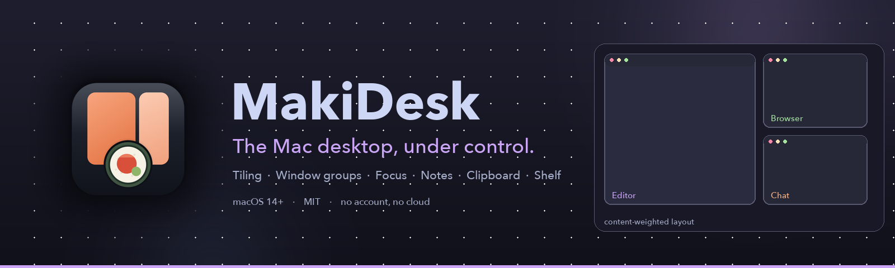
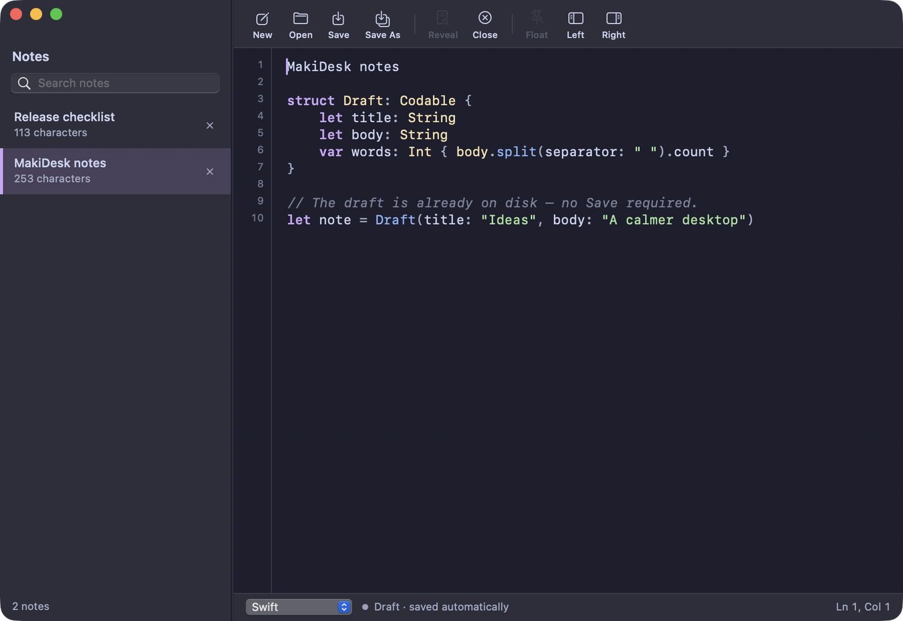
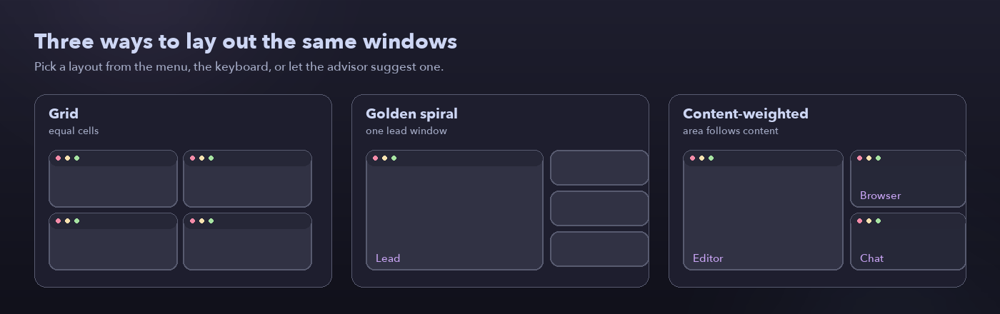
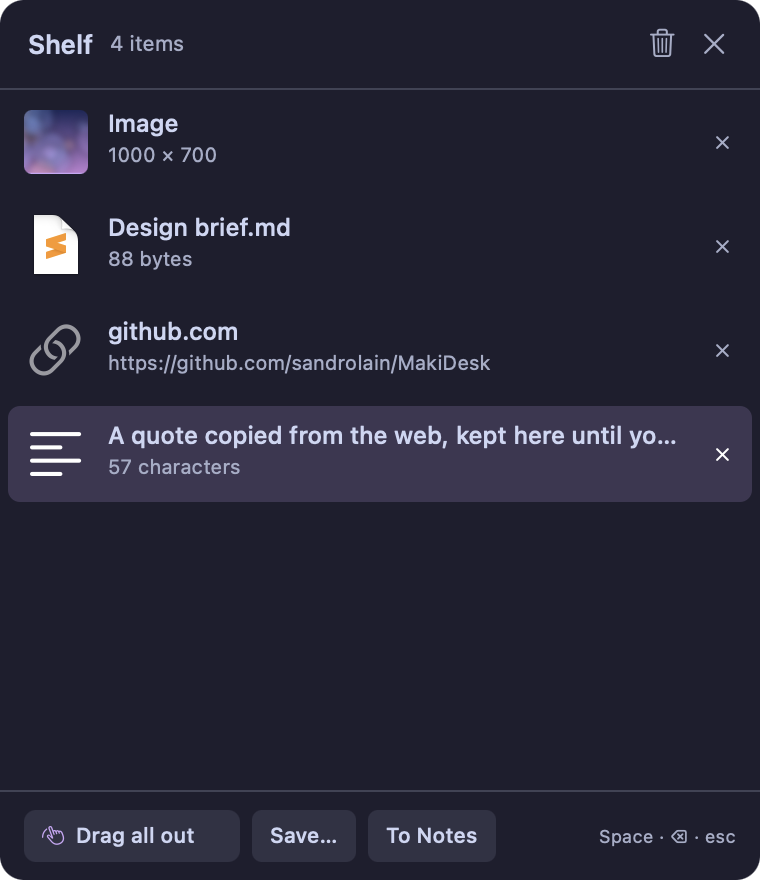
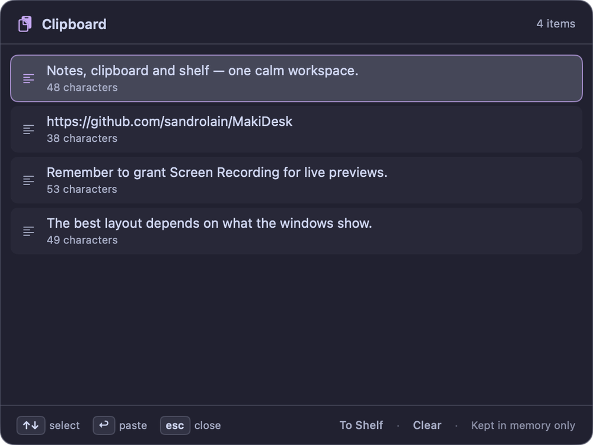
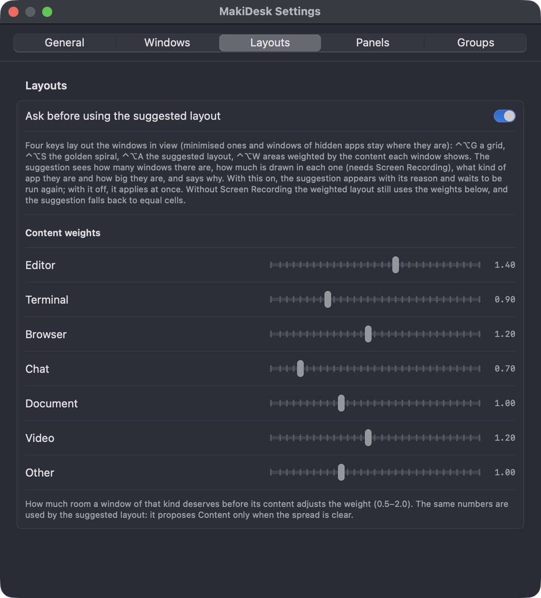
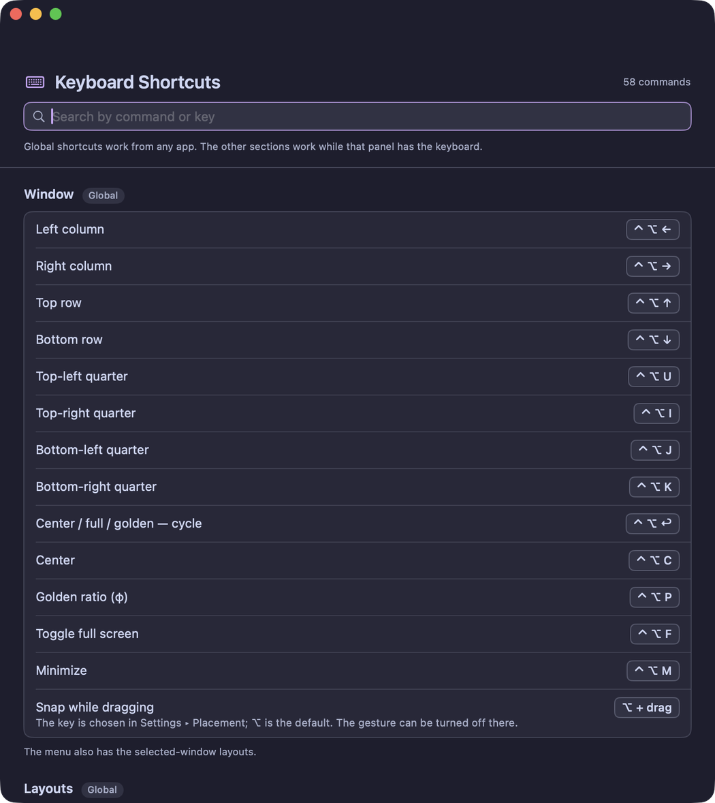

<p align="center">
  
</p>

<p align="center">
  <a href="https://github.com/sandrolain/MakiDesk/releases"></a>
  <a href="LICENSE"></a>
  
  
</p>

# MakiDesk

**The Mac desktop, under control.** MakiDesk is a native menu-bar app for macOS
14+ that arranges the windows you already have — no fake canvas, no second
desktop. Tiling that adapts to what you are reading, saved window groups, a live
switcher, notes with syntax highlighting, clipboard history, a drag shelf and
configurable command dropzones, all in one place. No account, no cloud, no
telemetry.

<p align="center">
  
</p>

## Features

### Tiling that thinks

Halves, quarters, golden positions, full screen and a configurable gap. The
arrow keys walk a ladder of positions, and both arrows of a pair held with `⌃⌥`
give the whole height (`↑`+`↓`) or width (`←`+`→`) at once; hold the snap key
while dragging to get the same positions with the mouse. MakiDesk replaces macOS's basic ⌥-tiling with
a richer one, and can turn the system one off for you. A focus border in the
theme accent follows the window receiving your keys, including MakiDesk's own
windows, and an optional focus dim takes the rest of the screen away — around
the focused window, the whole app, or a set of windows picked in the switcher.

<p align="center">
  
</p>

**Layouts with a reason.** `⌃⌥G` grid, `⌃⌥S` golden spiral, `⌃⌥A` suggested and
`⌃⌥W` content-weighted. The advisor reads the amount of content each window
shows (with Screen Recording), the kind of app and the window sizes, and says
why it chose a layout. The content-weighted layout is a squarified treemap:
areas follow a weight, not a fixed cell, and the seven app-kind weights are
editable in Settings. Each display is arranged in its own area, so a layout
never moves a window across monitors, and a window that cannot fit an app's own
minimum size is left where it is instead of being squeezed.

### A pointer you can find

`⌃⌥⇧P` pulses three rings around the pointer, on the display it is on: useful
on a large screen or a projector, and it needs no permission. `⌃⌥⇧X` starts a
presentation effect (five minutes by default, or with no time limit), or stops
it when pressed again. Choose an accent ring, tapered ribbon, moving particles,
orbiting dots or a spotlight in Settings ▸ Panels ▸ Pointer, where the particle
count and size and the number and size of the orbit dots are adjustable too;
click ripples can be enabled as well. It stops by itself unless you asked for no
limit, and is never left on. The system pointer is never replaced: the effect is
drawn around it, not over it.

### A switcher you will actually use

`⌥⇥` opens live previews of every window; `⌥Space` adds a search field that
filters windows and the applications installed on the Mac. The same field
calculates and converts units (`12 * 3`, `15% of 80`, `12 cm in in`,
`30 °C in °F`): Return copies the result. Releasing
Option or pressing Return opens the highlighted window; in the Applications
shelf Return launches the app. Pick windows for a layout, recall a saved group
from the side column, or close/quit/minimize the highlighted window without
leaving the grid. Previews stay current while the panel is open; the full-screen
switcher uses the same two keys.

### Groups, Focus and Peek

Keep up to nine sets of windows. `⌃⌥1…9` brings a group back where you left it
and puts the rest away; `⌃⌥⌘1…9` adds or removes the front window. Focus sends a
single window away (`⌃⌥⌘V`), brings everything back (`⌃⌥⌘A`) and undoes one step
(`⌃⌥⌘Z`). Peek (`⌃⌥⌘P`, hold `⌃⌥H`) keeps one designated window one key away.
The switcher's groups column can be hidden in Settings ▸ Panels, with its card
badges and its notices, for a palette as wide as the windows alone.

### Notes without the ceremony

A plain-text scratchpad that keeps drafts even when you never save them. Nine
syntax-highlighted languages, a searchable sidebar, external files opened as
drafts, a line-number gutter, and a panel you can dock to either screen edge.
External files are written only when you press `⌘S`.

### A checklist you cannot leave behind

`⌃⌥L` puts a small card over the desktop with the things you tick off: add,
tick, drag a row to reorder, delete, clear what is done. Its text is copyable
from the row menu, and the trash shares the add row and clears the completed
items, while the add field only appears when the card has the keyboard. It
keeps your corner, follows the active display (the monitor of the last window
focus or pointer move), sits on the same edge margin as a tiled window, and can
rest faint, turning solid as soon as the pointer is over it or you type in it.
It stays over the other apps without taking the keyboard — clicking the list
does, and `Esc` closes it — and its items come back after a restart. Left out of
screenshots; solid with Reduce Transparency.

### A timer that gets out of the way

`⌃⌥T` starts one: `25m`, `1h 30m`, or `8:30` for the next half past eight —
a colon is a time of day, so `1:30` is half past one at night — with an optional
label to tell them apart. Several run at once, nearest first, in a small card
that fades as the pointer comes near and returns when it leaves. A timer is a
deadline, so it is kept across launches: on the next start it has what is
really left, and one that ran out while the app was closed says so instead of
disappearing. The notice at the end stays until you click it away, offers **5
more minutes**, and a system sound rings — both chosen in Settings; the count is
read from the deadline, so sleeping cannot make it drift.

### Clipboard history, kept private

Text and images, in memory, never on disk. `⌥V` opens the list; Return or a
click pastes into the app you were using. At most 50 entries (pinned items can
exceed the limit), no duplicates, a bounded image budget, and password
fields/secure input are skipped. Pin an entry
to keep it across *Clear*; pins are in memory too. The panel will not even open
while secure input is active.

### Text from the screen

Press `⌃⌥⇧O` and drag over any text on screen: the words go to the clipboard,
the in-memory clipboard history, or both, with a short preview that can send
them to a note or the shelf. The menu reads the window under the pointer, the
frontmost window or the whole screen instead; a shelf image, a screenshot in the
library or an image already on the clipboard needs no capture and no permission
at all. Settings can keep the text off the system pasteboard (“history only”)
and open the history when appropriate. Recognition runs locally with Vision;
the picture is not written to disk and nothing is uploaded.

### Colour from the screen

Press `⌃⌥⇧E`, move the loupe and click: the colour under the point is on the
clipboard, as hex by default or as RGB, HSL or NSColor from Settings ▸ Panels.
The loupe shows a colour square and its hex value; values are converted to
sRGB, so they match other colour tools.

### Measure anything on screen

Press `⌃⌥⇧M` and drag: live width, height, ΔX/ΔY, diagonal, angle and area,
snapped to real window and display edges and centres, with a dashed magnetic
guide before the drag, locked on press, and on the snapped side while dragging.
Release to pin
the readout, copy it from its badge, and dismiss it with ✕ or Clear
Measurements.
`⇧` keeps a square, `⌥` measures from the centre; points, device pixels and
estimated millimetres or inches are in Settings.

<p align="center">
  
  &nbsp;&nbsp;
  
</p>

### A shelf for what you are dragging

Shake while dragging (or press `⌃⌥D`) to catch files, folders, links, text and
images. File promises from Photos, Safari and Mail work. Quick Look with Space,
drag everything out or one row, copy or move it to a folder, or send the selected
text straight to a new note. The shelf is temporary by design: it empties
when it closes and never keeps your files anywhere else.

**Dropzones** (Settings ▸ Dropzones, or the **Dropzones** menu) go one step
further: each one is a command you write, run on what you drop on its tile in the
strip that appears under the shelf — or on the shelf's selection, from the menu
or with `⌘D` and `↩`. Choose files, folders, images, text or links; use
placeholders such as `{paths}`, `{textfile}` and `{outdir}`; try it from
Settings. Start from a command preset (Reveal, ZIP, image conversion, checksums
and more), pick an SF Symbol or emoji from a preview list, and only compatible
zones appear while you drag, each showing what it will receive. A long command
shows its elapsed time and a **Stop** button in the shelf; the result can go to
the notice, the clipboard or the Shelf. The first run, and the first run after
the command changes, asks for confirmation; a preset that writes next to the
source (ZIP) checks the target and asks before replacing an existing file. The
Shortcuts picker only prefills `shortcuts run <UUID>`: the zone runs any CLI
command, never `sudo`.

### Keep screenshots out of the desktop clutter

Open **Screenshots** from the menu bar to browse captures in the folder macOS
uses for screenshots (Desktop by default); a change in System Settings ▸
Screenshots is picked up at the next launch. Search, select several, drag them
out, open or reveal them in Finder, preview with Space, move them to another
folder, or send them to the Trash. Resize the cards, sort by date, or group
captures by month or week. Choose **Folder…** to browse another directory, or
**Use System Folder** to follow macOS again. Renamed captures stay listed
through the Spotlight index, while the name scan keeps the list usable when the
index is off; the list refreshes when files change.

**Mark up while you capture.** `⌃⌥⇧S` selects an area and opens a small editor
over it: arrow, rectangle, pen, highlighter, a text label, a crop, and a mosaic
that hides what is private. ⌘Z undoes, Return saves, and the PNG lands on the
shelf ready to drag out (and on the clipboard, if you want it). The window in
front (`⌃⌥⇧W`) and the whole display (`⌃⌥⇧C`) use the same editor.

**Record an area.** `⌃⌥⇧R` records the area you drag, with the system's sound if
you want it; the menu bar pauses and stops, and the movie lands on the shelf.

### Applications, one keystroke away

`⌥Space` also opens applications: the shelf under the field starts on the ones
used most recently, Return opens or brings one forward, `⌘Return` asks for a new
instance. No Accessibility permission needed.

### Commands, typed

`⌃⌥R` opens a field for the menu in words: `tile left`, `layout grid`,
`group 3`, `timer 25m`, `screenshot`. The list filters as you type, Tab completes
the phrase, Return runs it; a wrong argument says what it expected instead of
running something else. Every row is an action MakiDesk already has.

### A utility bar that comes when called

Rest the pointer on the menu bar and a strip drops down: the everyday panels,
the capture tools, the Ports window, the presentation toggles, and the figures
worth glancing at — free disk, CPU, the windows in the switcher and the
countdown on Timer. Untick the buttons you never use. It appears after a
quarter of a second, retreats when the pointer leaves, takes no room from
windows and never takes the keyboard by itself. The pin keeps it out; `⌃⌥B`
opens it from the keyboard (arrows choose, Return runs, Esc closes), and
`utility bar`, `bar show`, `bar hide` and `bar pin` do the same from the command
box. Visibility, order and the words on each button live in a small JSON file
you can edit by hand. It is left out of screenshots and recordings.

### A terminal that outlives the menu bar

`⌃⌥O` opens **MakiDesk Terminal**, a separate helper with a real shell, a sidebar
of workspaces and split panes. Because it is a separate app, quitting MakiDesk
does not end its sessions; it appears in the Dock and ⌘Tab while its window is
open, and it restores the workspace layout and each shell's directory on the next
launch. `⌘F` searches the focused pane's scrollback and shows how many matches it
found, and an image on the clipboard is pasted as a PNG file path. An opt-in
switch in Settings adds Claude Code and Codex hooks, so the sidebar shows which
workspace is working, waiting or done. VoiceOver reads the pane as a text area
and dictation inserts at the cursor. The helper is embedded in the app bundle.

### Notices that stay readable

Results are reported by a small, themed notice. Its state tints the icon and
border — grey for information, accent for a confirmation, green for success,
orange for a warning, red for an error — and errors can be kept until you
click them away, while progress updates in place. A notice can offer an action:
the timer's *Time's up* brings **5 more minutes**. Two notices can be
visible at once without one hiding the other, and a notice waiting for you
never blocks the ones that close by themselves. Choose the corner, the display
and the text size in Settings ▸ Notifications, and open **Notification
History…** for the last 50 messages (memory only). Notices never end up in
screenshots or recordings.

### Free space, and a process that will not cool down

The free space on the start-up disk sits beside the menu-bar icon — the same
figure Finder shows, purgeable space included — and turns orange below the
warning level you set, with one notice a day offering Storage settings. The
**System** menu adds the strict count and the CPU watch: a process that stays
above the threshold for the whole window is named once, with what else is busy,
**Activity Monitor** and **Snooze 1 hour**. Root daemons the app cannot read are
reported honestly as *System processes*. The watch stops completely when it is
off, and an optional system notification respects Focus; the in-app notice needs
no permission. **Ports…** in the same menu lists the TCP sockets in `LISTEN` and
the process holding each one; Terminate asks first and sends `SIGTERM`, never
`sudo`.

### Small details, native feel

A theme that covers the panels, the Settings window, the overlay and the text
caret, configurable animations, a focus border, a searchable Keyboard Shortcuts window,
and Settings with a sidebar — General, Windows, Layouts, Panels, Notifications,
Groups, System and Dropzones — whose longer pages split into a strip of
sub-sections. The System theme borrows macOS materials for the utility bar and
floating cards (Liquid Glass on macOS 26 and later), stays solid under Reduce
Transparency, and custom themes keep their exact colours. Utility windows open
on the display where the focused window is, and recenter when they were last
used on another one.

<p align="center">
  
  &nbsp;&nbsp;
  
</p>

## Install

**Requirements:** macOS 14 or later; Apple Silicon for the current binary (the
source builds on Intel too); Accessibility and Screen Recording permissions.

### From source

```sh
git clone https://github.com/sandrolain/MakiDesk.git
cd MakiDesk
task open
```

`task open` builds a release bundle, signs it with a stable local identity and
launches `dist/MakiDesk.app`. See [Development](docs/DEVELOPMENT.md) for the
Taskfile commands and the signing notes.

> MakiDesk is not sandboxed and is distributed outside the Mac App Store: reading
> and moving other apps' windows requires Accessibility. It uses no account and
> no network service.

## Quick keys

| Shortcut | Action |
| --- | --- |
| `⌥⇥` | window switcher |
| `⌥Space` | search windows and applications |
| `⌃⌥W` | content-weighted layout |
| `⌃⌥⇧O` | text from a selected area |
| `⌃⌥⇧P` | locate pointer |
| `⌃⌥⇧X` | pointer effects on/off |
| `⌥N` | notes |
| `⌥V` | clipboard history |
| `⌃⌥D` | shelf |
| `⌃⌥L` | checklist |

Every command, including the panels' own keys, is in the **Keyboard Shortcuts**
window (menu bar or Settings ▸ General) and in the [usage guide](docs/USAGE.md#keyboard-shortcuts).
The four prefixes are written down: `⌥` the panels opened all day, `⌃⌥` the
window and the layouts, `⌃⌥⇧` the screen, `⌃⌥⌘` the desktop. Click a key there to record a
new combination, turn a command off or restore the defaults; the choice is
saved in `shortcuts.json` and survives a restart.

## Documentation

- [Usage guide](docs/USAGE.md) — every panel, gesture and shortcut
- [Development](docs/DEVELOPMENT.md) — build, tasks, tests, signing
- [Architecture](docs/ARCHITECTURE.md) — modules, layout engines, persistence
- [Distribution](docs/DISTRIBUTION.md) — DMG, Developer ID, notarization
- [Privacy](docs/PRIVACY.md) — permissions, local data, clipboard/shelf

## Privacy

No account, no telemetry, no analytics, no cloud. Notes and groups stay in
`~/Library/Application Support/MakiDesk/`; clipboard history is in memory only;
shelf files are references to your own files, with a temporary staging folder
for file promises that is removed when the shelf closes. Window previews are
kept in memory and never uploaded. See [Privacy](docs/PRIVACY.md) for the
permissions and the full picture.

## License

MakiDesk is released under the [MIT License](LICENSE). Third-party components
and their licences are listed in [THIRD_PARTY_NOTICES.md](THIRD_PARTY_NOTICES.md).

<p align="center">
  <sub>Built for macOS. Local by design.</sub>
</p>
