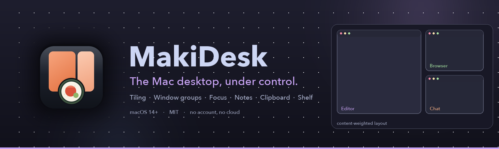
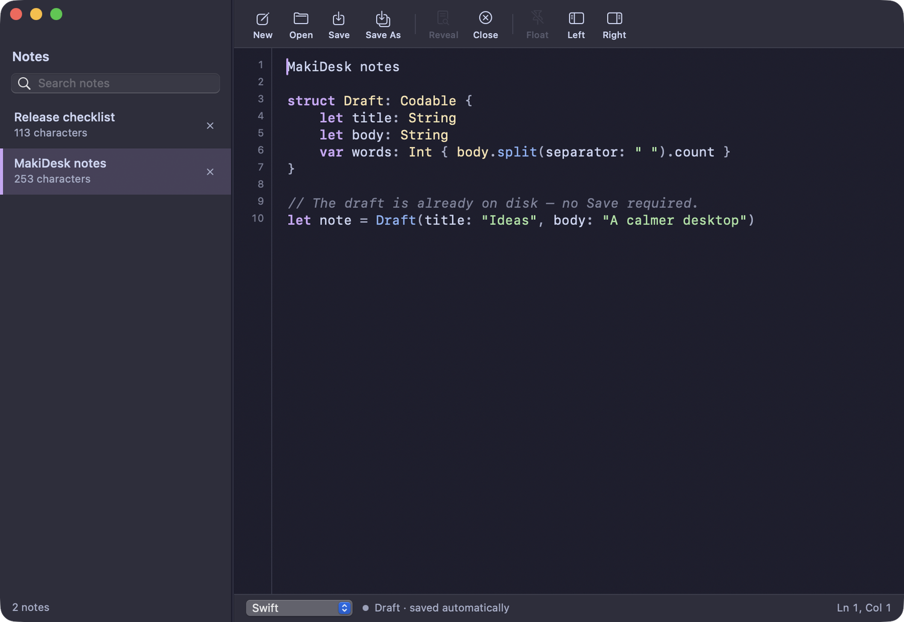
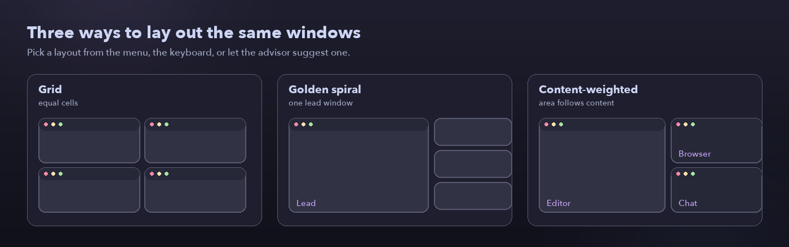
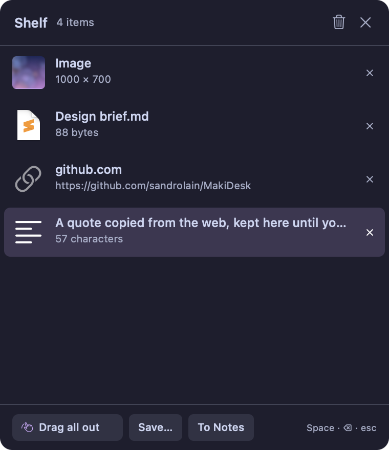
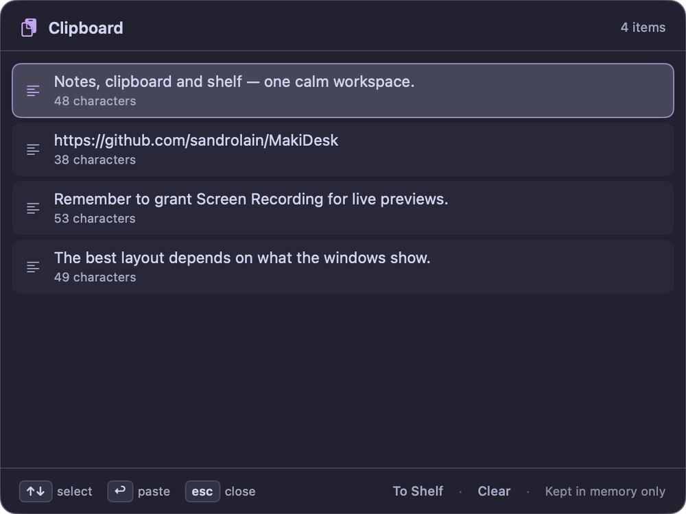
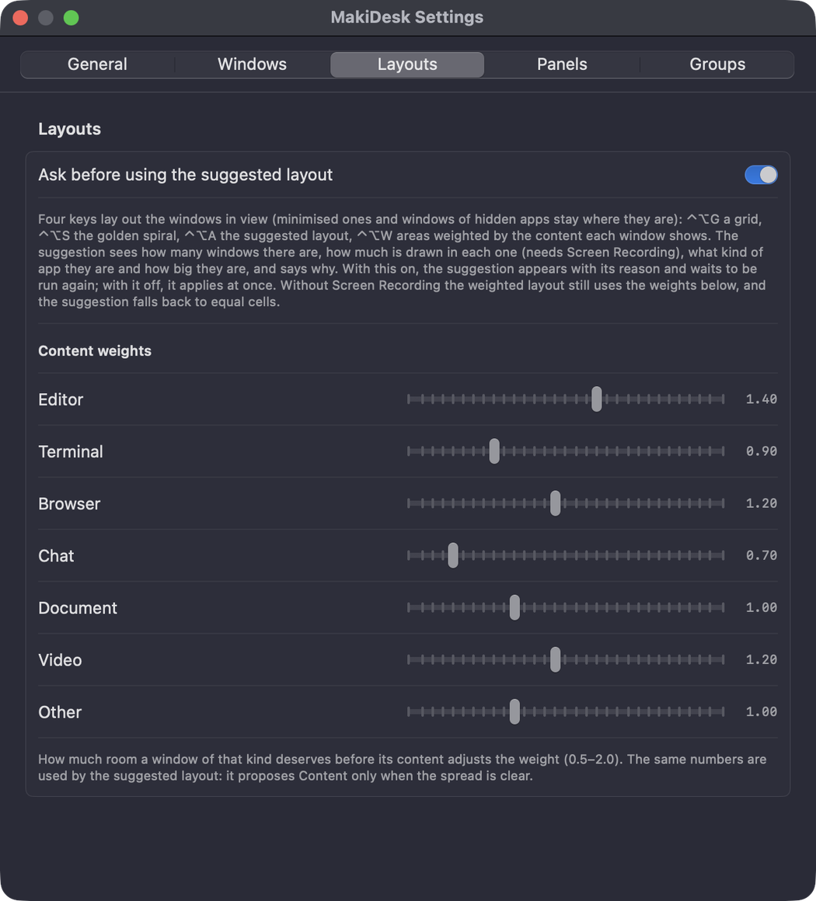
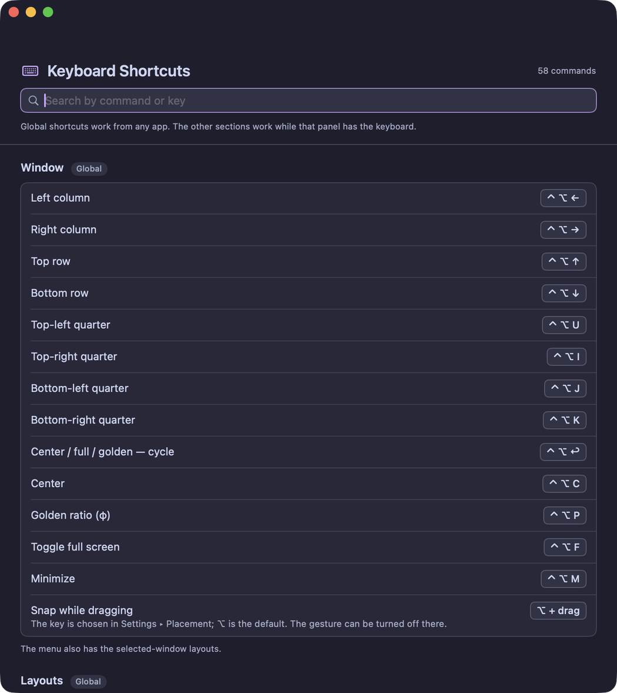

<p align="center">
  
</p>

<p align="center">
  <a href="https://github.com/sandrolain/MakiDesk/releases"></a>
  <a href="LICENSE"></a>
  
  
</p>

# MakiDesk

**The Mac desktop, under control.** MakiDesk is a native menu-bar app for macOS
14+ that arranges the windows you already have — no fake canvas, no second
desktop. Tiling that adapts to what you are reading, saved window groups, a live
switcher, notes with syntax highlighting, clipboard history and a drag shelf,
all in one place. No account, no cloud, no telemetry.

<p align="center">
  
</p>

## Features

### Tiling that thinks

Halves, quarters, golden positions, full screen and a configurable gap. The
arrow keys walk a ladder of positions; hold the snap key while dragging to get
the same positions with the mouse. MakiDesk replaces macOS's basic ⌥-tiling with
a richer one, and can turn the system one off for you. A focus border in the
theme accent follows the window receiving your keys, including MakiDesk's own
windows.

<p align="center">
  
</p>

**Layouts with a reason.** `⌃⌥G` grid, `⌃⌥S` golden spiral, `⌃⌥A` suggested and
`⌃⌥W` content-weighted. The advisor reads the amount of content each window
shows (with Screen Recording), the kind of app and the window sizes, and says
why it chose a layout. The content-weighted layout is a squarified treemap:
areas follow a weight, not a fixed cell, and the seven app-kind weights are
editable in Settings.

### A switcher you will actually use

`⌥⇥` opens live previews of every window; `⌥Space` adds a search field. Releasing
Option or pressing Return opens the highlighted window. Pick windows for a
layout, recall a saved group from the side column, or close/quit/minimize the
highlighted window without leaving the grid. Previews stay current while the
panel is open; the full-screen switcher uses the same two keys.

### Groups, Focus and Peek

Keep up to nine sets of windows. `⌃⌥1…9` brings a group back where you left it
and puts the rest away; `⌃⌥⌘1…9` adds or removes the front window. Focus sends a
single window away (`⌃⌥V`), brings everything back (`⌃⌥⇧A`) and undoes one step
(`⌃⌥Z`). Peek (`⌃⌥⌘P`, hold `⌃⌥H`) keeps one designated window one key away.

### Notes without the ceremony

A plain-text scratchpad that keeps drafts even when you never save them. Nine
syntax-highlighted languages, a searchable sidebar, external files opened as
drafts, a line-number gutter, and a panel you can dock to either screen edge.
External files are written only when you press `⌘S`.

### Clipboard history, kept private

Text only, in memory, never on disk. `⌥V` opens the list; Return or a click
pastes into the app you were using. At most 50 distinct texts, no duplicates,
and password fields/secure input are skipped. The panel will not even open while
secure input is active.

<p align="center">
  
  &nbsp;&nbsp;
  
</p>

### A shelf for what you are dragging

Shake while dragging (or press `⌃⌥D`) to catch files, folders, links, text and
images. File promises from Photos, Safari and Mail work. Quick Look with Space,
drag everything out or one row, copy or move it to a folder, or send the selected
text straight to the open note. The shelf is temporary by design: it empties
when it closes and never keeps your files anywhere else.

### Small details, native feel

A theme that covers the panels, the Settings window and the overlay,
configurable animations, a focus border, a searchable Keyboard Shortcuts window
with all 58 commands, and Settings split into General, Windows, Layouts, Panels
and Groups.

<p align="center">
  
  &nbsp;&nbsp;
  
</p>

## Install

**Requirements:** macOS 14 or later; Apple Silicon for the current binary (the
source builds on Intel too); Accessibility and Screen Recording permissions.

### From source

```sh
git clone https://github.com/sandrolain/MakiDesk.git
cd MakiDesk
task open
```

`task open` builds a release bundle, signs it with a stable local identity and
launches `dist/MakiDesk.app`. See [Development](docs/DEVELOPMENT.md) for the
Taskfile commands and the signing notes.

> MakiDesk is not sandboxed and is distributed outside the Mac App Store: reading
> and moving other apps' windows requires Accessibility. It uses no account and
> no network service.

## Quick keys

| Shortcut | Action |
| --- | --- |
| `⌥⇥` | window switcher |
| `⌥Space` | search windows |
| `⌃⌥W` | content-weighted layout |
| `⌥N` | notes |
| `⌥V` | clipboard history |
| `⌃⌥D` | shelf |

Every command, including the panels' own keys, is in the **Keyboard Shortcuts**
window (menu bar or Settings ▸ General) and in the [usage guide](docs/USAGE.md#keyboard-shortcuts).

## Documentation

- [Usage guide](docs/USAGE.md) — every panel, gesture and shortcut
- [Development](docs/DEVELOPMENT.md) — build, tasks, tests, signing
- [Architecture](docs/ARCHITECTURE.md) — modules, layout engines, persistence
- [Distribution](docs/DISTRIBUTION.md) — DMG, Developer ID, notarization
- [Privacy](docs/PRIVACY.md) — permissions, local data, clipboard/shelf

## Privacy

No account, no telemetry, no analytics, no cloud. Notes and groups stay in
`~/Library/Application Support/MakiDesk/`; clipboard history is in memory only;
shelf files are references to your own files, with a temporary staging folder
for file promises that is removed when the shelf closes. Window previews are
kept in memory and never uploaded. See [Privacy](docs/PRIVACY.md) for the
permissions and the full picture.

## License

MakiDesk is released under the [MIT License](LICENSE). Third-party components
and their licences are listed in [THIRD_PARTY_NOTICES.md](THIRD_PARTY_NOTICES.md).

<p align="center">
  <sub>Built for macOS. Local by design.</sub>
</p>
